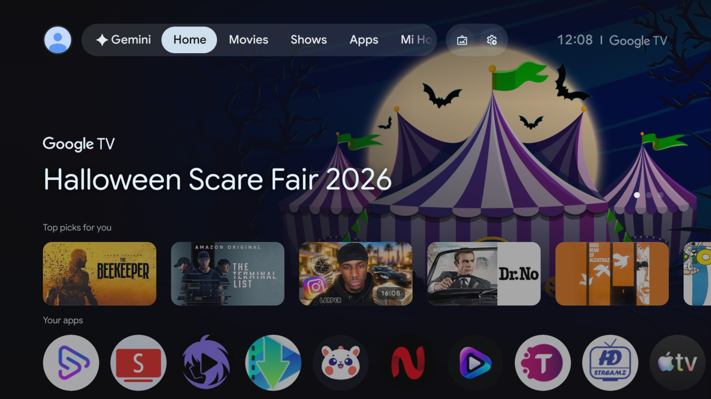
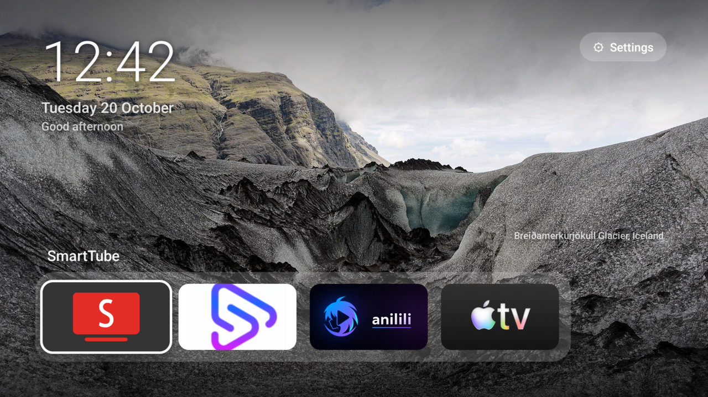
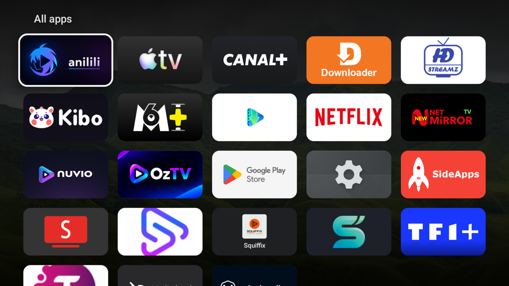
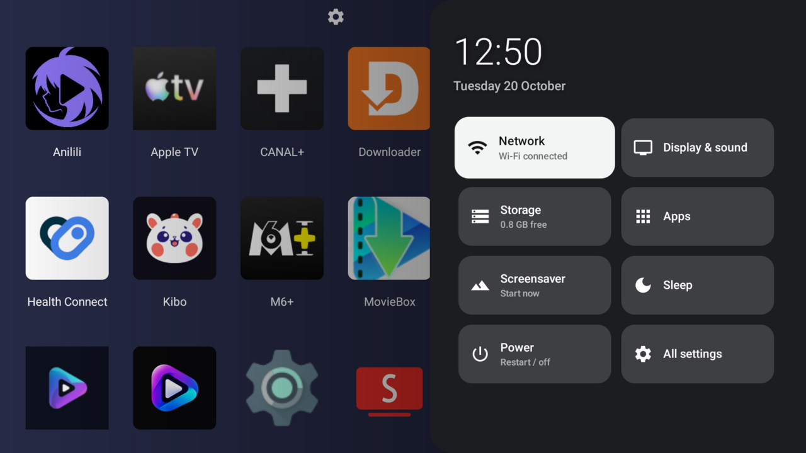

# Mi TV Stick debloat + TV Home launcher

Debloat a Xiaomi Mi TV Stick (Google TV, Android 14) over ADB and replace the ad-filled Google TV
home with a fast, minimal Apple TV-style launcher. Inspired by
[mihirgupta0900/tv-home](https://github.com/mihirgupta0900/tv-home).

| Before | After |
|---|---|
|  |  |
|  |  |

## Setup
```bash
tools/setup.sh                      # downloads adb + Android SDK build tools into tools/
echo "<tv-ip>:5555" > .tv           # your TV's address (git-ignored); or pass TV=... per command
tools/platform-tools/adb connect "$(cat .tv)"   # accept the prompt on the TV
```
Enable *Developer options → USB/Network debugging* on the TV first.

Everything here is reversible: apps are only *disabled* (`pm disable-user`), never uninstalled.

| File | What it does |
|---|---|
| `backup.sh` | Run first: snapshots package states, settings and the default launcher |
| `backup/<timestamp>/` | Snapshot taken before any change: package states, all settings, default launcher (git-ignored) |
| `backup/debloat-applied.txt` | Log of every package we disabled (read by `restore.sh`) |
| `debloat.sh` | Disables Xiaomi ads/telemetry and unused features; animations set to 0.5x |
| `launcher/` | TV Home source (plain Java, no Gradle) + `build-and-install.sh` |
| `set-launcher.sh` | Makes TV Home the Home button launcher, Nature Slideshow the screensaver, and enables hold-Home quick panel |
| `restore.sh` | Undo everything (`--remove-launcher` also uninstalls TV Home) |
| `tools/setup.sh` | Fetches adb and the SDK build tools locally |

## Using the home screen
- **Left/Right** move along the dock; the app name shows above it. **OK** opens the app.
- **Down** goes to *All apps*. **Back** or **Home** returns to the dock.
- **Long-press OK** (or Menu) on any app: add to dock / move left / move right / remove / app info.
- **Hold Home** anywhere (even inside an app) for the quick panel: Network, Display & sound, Storage,
  Apps, Screensaver, Power (sleep / restart) and All settings. Back closes it and returns to the app.
  It works through a small accessibility service ("TV Home quick panel") that only watches the Home key.
- Wallpapers crossfade every 10 minutes (screensaver: every minute). Add or replace JPEGs in
  `launcher/assets/wallpapers/` (1920x1080) and add a caption line to `credits.txt`, then rebuild.

## Common tasks
```bash
./backup.sh && ./debloat.sh && launcher/build-and-install.sh && ./set-launcher.sh   # first-time setup
./launcher/build-and-install.sh     # rebuild + reinstall after editing the launcher
./debloat.sh && ./set-launcher.sh   # re-apply after a firmware update re-enables things
./restore.sh                        # back to stock Google TV
```
To test the hold-Home panel over ADB use `adb shell uinput /data/local/tmp/hold-home.json`
(push `tools/hold-home.json` first); `adb shell input keyevent` bypasses accessibility, so it can't trigger it.

If the TV's ADB is off (it turns off after a reboot), re-enable it in
Settings -> System -> Developer options, then `tools/platform-tools/adb connect "$(cat .tv)"`.

Wallpapers: Wikimedia Commons Featured Pictures (CC BY-SA / public domain).
